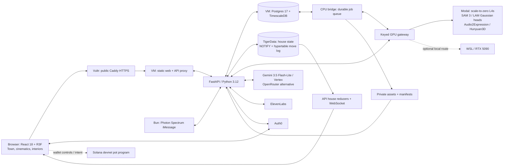
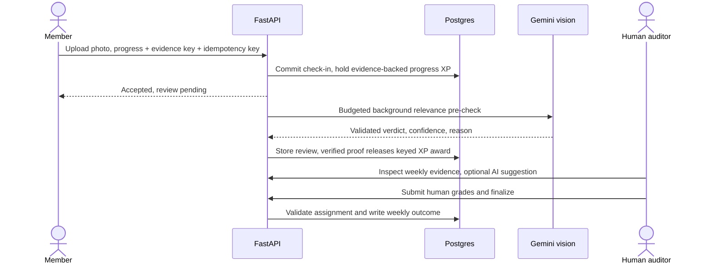
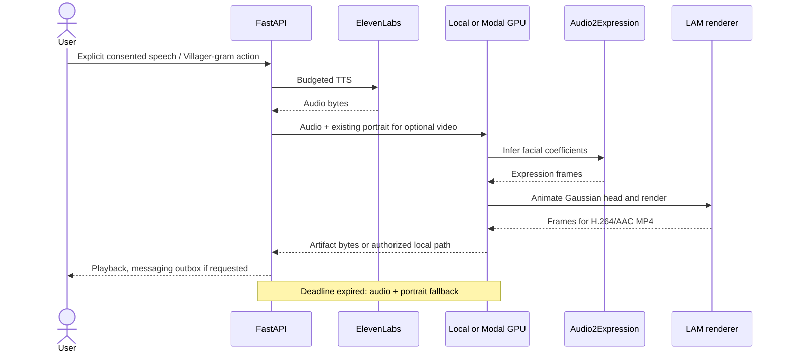

# Village

[Live village](https://thefriendshipvillage.vodka) · [Setup: all services](docs/SETUP.md) · [Devpost write-up](docs/devpost/SUBMISSION.md) · [Trailer](docs/devpost/video/TRAILER.md) · [Demo script](docs/devpost/DEMO_SCRIPT.md) · [Demo Lab](https://thefriendshipvillage.vodka/lab)

Village turns a friend group's weekly goals into a shared browser town: each member has a home, an avatar, a progress history and a human auditor. Check-ins produce durable records; coins buy cosmetics, while lifetime XP measures progress. A bounded AI Mayor summarizes activity and proposes events. Consented photos and voices can produce personalized characters and talking messages, but procedural avatars keep the town usable without generated assets or a GPU. React renders the experience; FastAPI owns authorization and rewards; Postgres owns durable state.

Source review: **DOCS-015, production baseline 86bc24e, October 11, 2026**. Includes Mayor-selected repair tasks (FEAT-028), optional Auth0 seat claims (FEAT-029), Solana v2 payment code (FEAT-027), and WEB-058 usability fixes. Deployment claims follow checked-in evidence, not a new live rehearsal. [Architecture](docs/ARCHITECTURE.md) explains failure boundaries; [publication audit](docs/security/REPO-AUDIT.md) covers history risks. Product intent: [Hackathon.pdf](Hackathon.pdf).



[Production Caddy](ops/deploy/prod.Caddyfile) serves the SPA and proxies `/api/*`, including WebSockets, to loopback FastAPI. The [cutover runbook](ops/deploy/cutover.md) records VM production serving; desktop reverse-tunnel diagrams are historical. The GPU bridge shares the API's asset disk, independently of where inference runs.

## Data model

[The baseline schema](packages/contracts/schema.sql) and [migrations](apps/api/migrations/) define users, villages, memberships, goals, check-ins, evidence reviews, weekly audits, competitions, inventory, avatars and messages. Transactions establish authoritative results; the browser projects them.

- `xp_ledger` stores progress; `coin_ledger` stores spendable credits/debits. Unique `source_key` values prevent repeated awards. Member locks serialize balance checks and spending in [domain.py](apps/api/app/domain.py).
- `check_in_keys` protects retries independently of time-partitioned check-ins. Job idempotency keys, manifest revisions, inbound receipts and `mayor_outbox` cover asynchronous work.
- The historical migration range is **001–059**, not 59 files: the consolidated baseline carries earlier work; incremental files run from 003 through 059 with gaps. The latest additions are 056 overworld, 057 Solana payments, 058 repair tasks and 059 seat claims. [migrate.py](apps/api/scripts/migrate.py) initializes fresh databases, then records incremental filenames in `api_migrations`.

## Realtime

[House reducers](apps/api/app/houses.py) lock a room, validate permissions, inventory, bounds and overlap, increment its sequence, update furniture, append a move and call `pg_notify` transactionally. Authenticated WebSockets subscribe before taking a snapshot; committed deltas update interiors.

- `TIGER_DATABASE_URL` selects TigerData; omission uses the main pool. A configured Tiger outage does not automatically fail over to another writable copy.
- [Migration 050](apps/api/migrations/050_house_interiors.sql) creates a hypertable when Timescale exists; [Tiger setup](apps/api/scripts/tiger_migrate.py) adds hourly activity aggregation.
- [Village presence](apps/api/app/presence.py) supplies online status. [Overworld reducers](apps/api/app/overworld.py) now synchronize walking, activities, seats and attractions through authenticated WebSockets, with persisted snapshots and idempotent intents. The authority is single-process; this is not a multi-replica simulation server.

## Avatar pipeline

[The bridge](workers/gpu/bridge.py) claims jobs with `FOR UPDATE SKIP LOCKED`, leases and bounded retries. Photos pass through SAM 3 segmentation, LAM Gaussian portraits and optional stylized Hunyuan3D meshes. Walking characters retain preset rigs; a generated mesh head does not imply a generated animated body.

- Manifests advance transactionally with job completion and follow-up enqueueing. Failed later stages preserve usable revisions; [OptionalModel](apps/web/src/scene/OptionalModel.tsx) supplies missing-model fallbacks.
- [Modal](workers/modal/app.py) has four L4 classes: SAM, LAM, Audio2Expression and Hunyuan. Each allows zero minimum/one maximum container, 120-second scale-down and 600-second calls. Multipart inputs and returned bytes replace desktop paths; `X-GPU-Key` protects the gateway.
- [Historical measurements](workers/modal/README.md) estimate short talking clips at $0.034 cold/$0.002 warm and LAM head bakes at $0.038/$0.011. These are workload estimates, not current prices or complete bills; storage, grace periods and provider calls add costs.

## LLM layer

[Mayor](apps/api/app/mayor.py) requests bounded JSON, validates Pydantic schemas and records provenance. Gemini defaults to `gemini-3.5-flash-lite` through Vertex. General adapter configuration defaults to OpenRouter first, then Gemini; environment settings select precedence. Evidence vision calls Gemini directly.

- Text, image text, messages and on-chain content are untrusted data. Server code validates proposed effects; model output cannot execute arbitrary actions.
- Provider failure can produce labeled deterministic content. Evidence failure records `error` and requires owner review; it does not certify proof. Budget denial cannot become a free event through fallback.
- [Daily caps](apps/api/app/security.py) and a [durable hourly LLM budget](apps/api/app/budget.py) charge physical attempts, including repair/fallback. Development disables the optional scheduler.



The background pre-check and weekly human grade are distinct. Owners can override check-in reviews. [auditor.py](apps/api/app/auditor.py) and [weekly.py](apps/api/app/weekly.py) enforce these transitions; acknowledgement does not mean background completion.

## Disaster repair

The [Mayor repair planner](apps/api/app/repair_plans.py) selects 2–3 distinct tasks from seven allowed activities: photo check-ins, hanging out, working out, studying, cooking, calling a friend or helping a neighbor. Targets are bounded to 1–6 verified photo updates. The UI shows progress and a 2–4 sentence public rationale under “Why the Mayor chose these,” with provider/example provenance.

[Repair progress](apps/api/app/disasters.py) counts distinct evidence assets tagged to the active repair event whose latest review is verified. All task targets must be met; untagged check-ins do not complete a new plan. Legacy disasters retain their check-in rules. Offline or capped planning returns a labeled example; public status messages are not private model reasoning.

## iMessage

[The Bun/Spectrum agent](apps/imessage/src/agent.ts) translates commands and bounded photos into service-authenticated API calls; it never connects to Postgres. Inbound IDs deduplicate effects; outbox leases and acknowledgements record outbound attempts.

- Keyword queries need no LLM. Other chat, prayer and evidence use bounded providers. Replies identify AI content; proactive delivery checks consent.
- STOP cancels pending outreach but cannot retract in-flight sends. Delivery remains at-least-once: a crash between send and acknowledgement can duplicate a message.
- [Villager-gram video](apps/api/app/gram_video.py) has a persisted 120-second delivery deadline. Late cold renders yield audio/portrait fallback. Worker success alone does not prove handset receipt.



## Economy

[Coins](apps/api/migrations/027_coins.sql) buy clothing, furniture and upgrades. XP measures lifetime progress and levels; it is never spent. Weekly review and competitions have distinct grading/reward rules.

- [Solana v2](docs/solana/FEAT-027.md) implements immutable winner-take-all, proportional and ranked payouts. Wallet flows separate simulation, review, sign/send and server-verified receipts; SOL entries cannot be accepted as unpaid intent. Coin payouts are transactional.
- Shop → Treasury converts devnet SOL into personal XP after verified confirmation (100,000 lamports/XP; 1,000 XP/account/UTC intent date across villages). Pending intents reserve that day's allowance. It grants neither coins nor shared village XP.
- D-030 records a v1 devnet deployment. The new account ABI requires a separately approved v2 address if v1 pots exist; this checkout does not establish a live v2 deployment.
- No mainnet flow is claimed. Signing/sending requires owner approval; fixture mode and documentation checks move no funds.

## Security

[SEC-001](docs/security/SEC-001.md) bounds costly operations and isolates debug routes. Optional Auth0 Sign in verifies normal accounts; single-use operator codes link them to existing seats without losing progress. Codes expire in 72 hours and are stored as hashes. Demo seats remain impersonable even after linking. The current [production build](ops/deploy/prod-build.sh) deliberately sets `VITE_DEMO_AUTH=1`; a seat picker is not an account boundary. Production tooling defaults `VITE_AUTH0_ENABLED=0`, hiding Sign in. An owner-approved rebuild with `1`, configured public Auth0 values and tenant origins enables it; see the [seat-claim runbook](docs/auth/JUDGE_LOGIN.md). Hiding the UI does not disable API bearer validation.

- Daily global/IP/seat caps: LLM **300/60/40**, ElevenLabs **60/15/10**, GPU **40/10/8**, Photon dispatch **30/30/10**, queue **30/10/6**. Most are process-local UTC counters that reset on restart; ElevenLabs persists shared counters in SQLite under `ASSET_DIR`. They count operations, not dollars, and are not complete provider spending guarantees.
- Debug requires `DEMO_DEBUG`, a loopback peer and no `X-Forwarded-For`. Only peer `127.0.0.1` can supply a trusted forwarded address; the rightmost validated address is used. Uvicorn's `--no-proxy-headers` preserves this distinction.
- Secrets load at runtime from `VILLAGE_ENV_FILE` or protected service environments. Never place credentials in `VITE_*`, traces or commits. Address the [history audit](docs/security/REPO-AUDIT.md) before publication.

## Performance & scale

[SCALE-001](docs/perf/SCALE-001.md) measured 100 synthetic residents on a shared 16-vCPU runner using ASGI and Chromium/SwiftShader without generated models. This does not establish 100 simultaneous full clients.

- Catalog caching reduced village p95 **579.68 → 248.30 ms** and profile p95 **235.39 → 65.85 ms**. Review pages fetch ten profiles; feeds remain bounded.
- [Trees](apps/web/src/scene/InstancedTrees.tsx) and [town geometry](apps/web/src/scene/GridTown.tsx) use instancing. [Crowd detail](apps/web/src/scene/CrowdDetail.tsx) limits ordinary detailed bodies above 25 residents; label culling caps visible tags at 24 with player/selection priority.
- Overview draw calls fell **1,212 → 848**, heap **82.2 → 68.7 MiB**. Software FPS remained poor; street p95 frame time was **450 ms**. LOD does not prove smooth hardware rendering.

## Infra & delivery

Codex/Claude workers use scoped tasks and separate branches/worktrees; the integrator owns contracts and merges. [Remote runners](docs/infra/REMOTE_RUNNER.md) exclude env files, cache dependencies and supply disposable API databases.

- [DEPLOY-002](docs/infra/PRODUCTION-DEPLOYS.md) builds while the old release serves, applies compatible migrations, swaps a release symlink, restarts API/bridge/web, probes HTTP/DB/WebSocket readiness and rolls code back on failure. iMessage needs a separate restart.
- Activation interrupts service: scratch bounded-stop measurements were **5.3–5.4 seconds**, not a production SLA. Schema changes are not rolled back.
- [Modal's budget guard](workers/modal/budget_guard.sh) polls spend and stops the app at a default $25 threshold against a $30 budget. Delayed metering can overshoot; four GPU classes can run, so the older two-class cost ceiling is incorrect.

## Local dev

[The complete setup guide](docs/SETUP.md) covers credentials, service tiers recorded by the team, smoke tests, cost caps, isolated local databases, remote runners and production updates. The hidden `/lab` route offers browser-local town, disaster, futures, onboarding and avatar-pipeline demonstrations; reload resets local edits. Connected Avatar studio may read permitted cached assets. Disasters & repair includes “Ask the Mayor,” public selection status, per-task simulation and the repair reveal. That button directly requests a stateless, capped API plan even with `VITE_MOCK=1`; connected use can incur an LLM call. The offline command below points the proxy at unused loopback port 9 so it falls back to a labeled example.

Use Bun, Node/npm and Python 3.12 with uv. Commands use Bash from repository root; Windows uses Git Bash. Fixture mode needs no database, secrets or GPU. Choose a free port; preserve the shared demo on 8010/4173.

```bash
cd apps/web
bun install --frozen-lockfile
VITE_MOCK=1 VITE_DEMO_AUTH=1 VITE_AUTH0_ENABLED=0 VILLAGE_API_URL=http://127.0.0.1:9 bun run dev --host 127.0.0.1 --port 4174
```

Open `http://127.0.0.1:4174`. Postinstall uses npm for the nested wallet panel. Fixture API responses are simulated and reset on refresh. Keep port 9 unused; an expected proxy connection error from the Lab request selects its offline example.

For connected development, first provision a **dedicated scratch Postgres/Timescale database**. Set `VILLAGE_ENV_FILE` to the existing private file and override `DATABASE_URL` in the process with the scratch connection. Never initialize the shared demo. From root, in another terminal:

```bash
cd apps/api
export TIGER_DATABASE_URL= GOOGLE_API_KEY= OPENROUTER_API_KEY= ELEVENLABS_API_KEY=
export GPU_WORKER_URL= GPU_FALLBACK_URL=
python -m uv sync --frozen --python 3.12
python -m uv run python scripts/migrate.py
python -m uv run python scripts/seed.py
DEMO_AUTH=1 DEMO_DEBUG=0 MAYOR_SCHEDULER=0 MAYOR_VOICE=0 \
  python -m uv run uvicorn app.main:app --host 127.0.0.1 --port 8016 --no-proxy-headers
```

Windows also needs `export UVICORN_LOOP=app.runtime:selector_loop`. In `apps/web`, replace the fixture launch with:

```bash
VITE_MOCK=0 VITE_DEMO_AUTH=1 VITE_AUTH0_ENABLED=0 VILLAGE_API_URL=http://127.0.0.1:8016 \
  bun run dev --host 127.0.0.1 --port 4174
```

The empty process overrides keep rehearsal calls away from private-file provider and Tiger settings. The API loader preserves explicit process values. These terminals do not start the GPU bridge or iMessage agent. Open `http://127.0.0.1:8016/docs` to inspect the connected contract and `/api/health` to distinguish database availability from GPU availability. A down GPU is expected here. In the browser, a connected seat should load the seeded village; this proves startup and routing, not inference or real message delivery.

To diagnose a failed startup, check that the database exists, migrations finished and the requested port is free. If the browser reports authentication failure, align its demo flag with `DEMO_AUTH` on this isolated API. Restart Vite after changing its proxy target. For production builds, browser flags must be set before compilation; changing only the server environment afterward does not change the shipped bundle.

Environment names: `DATABASE_URL`, `TIGER_DATABASE_URL`, `ASSET_DIR`, `SERVICE_KEY`; `AUTH0_DOMAIN`, `AUTH0_AUDIENCE`, `VITE_AUTH0_DOMAIN`, `VITE_AUTH0_CLIENT_ID`, `VITE_AUTH0_AUDIENCE`, `VITE_AUTH0_ENABLED`; browser debug opt-in `VITE_DEMO_DEBUG`; `LLM_PROVIDER`, `GOOGLE_API_KEY`, `GOOGLE_GENAI_USE_VERTEXAI`, `GEMINI_MODEL`, `OPENROUTER_API_KEY`, `ELEVENLABS_API_KEY`; `GPU_WORKER_URL`, `GPU_FALLBACK_URL`, `GPU_FALLBACK_KEY`; Photon `PROJECT_ID`, `PROJECT_SECRET`. Omit Tiger for a single scratch database; leave optional providers unconfigured for a cost-free rehearsal. See [validation evidence](docs/architecture/VALIDATION.md).

When `RUNNER_IP` is configured, use the wrapper for heavy checks, from the owning app:

```bash
cd apps/web
../../ops/remote_run.sh bun run test
../../ops/remote_run.sh bun run build
```

## Demo and video handoff

WEB-058 keeps mobile Colosseum filters separate from terms, makes primary navigation reachable, and starts the phone dashboard collapsed. Labels leave building signs clickable; meaningful competitions with activity sort ahead of empty ones without deleting records. Feed rows open their selected event, badges use readable names/dates, Gazette copy is normalized, and the debug probe runs only with `VITE_DEMO_DEBUG=1`.

The [trailer handoff](docs/devpost/video/TRAILER-005.md) covers the **2:48 Devpost video**, **1:30 short cut**, and **39-second square**. The original [v4 master](docs/devpost/video/TRAILER.md) is **94 seconds**. MP4s are ignored by Git; the team supplies the files and uploads the selected film to Devpost's video host. No published video URL is recorded here. The local player needs those separately delivered files.

## Repo map

```text
apps/web/              React, R3F, interiors, cinematics, fixtures
apps/api/              FastAPI, providers, migrations and tests
apps/imessage/         Spectrum agent; API HTTP only
apps/activity/         Optional Discord/Steam activity collector
apps/trailer/          Submission trailer tooling
workers/gpu/           Local models and durable DB bridge
workers/modal/         Cloud inference gateway and budget guard
packages/contracts/    Integrator-owned HTTP shapes, schema, fixtures
packages/catalog/      Item/furniture definitions
packages/lam-renderer/  Browser portrait renderer integration
programs/              Anchor devnet pot and local program tests
ops/                   Runners, deployment, operational tools
infra/                 VM/container provisioning
assets/                Procedural sources, previews, audio
docs/                  Decisions, tasks, evidence, architecture
tests/                 Cross-component checks
tools/                 Asset and development helper scripts
.github/               Issue and pull-request templates
```

## Contributing

Read [AGENTS.md](AGENTS.md), your task's allowed paths and [decisions](docs/DECISIONS.md). Commit small milestones on your assigned branch; report exact isolated test commands/exits. Never push to main, merge, copy secrets, commit personal media or trigger debug actions on the shared village. Propose contract changes to the integrator. PRs distinguish tested behavior from simulation and include UI evidence where applicable.

Source code is MIT-licensed (see `LICENSE`); third-party models, model weights, services and their outputs keep their own terms (see `THIRD_PARTY_NOTICES.md`). Model, generated-asset and provider terms remain separate. Review the architecture's licensing limitations before redistribution.
