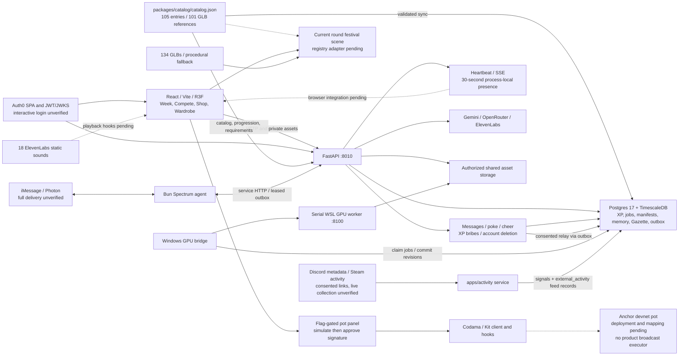
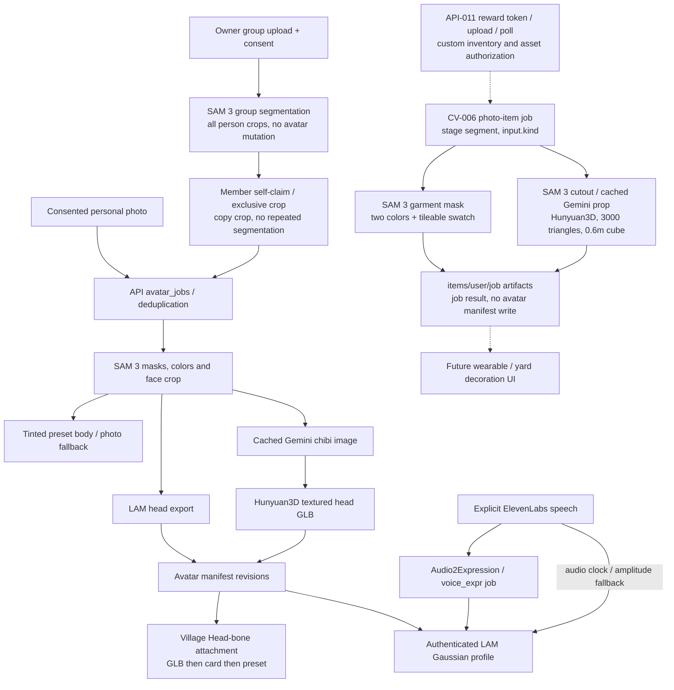
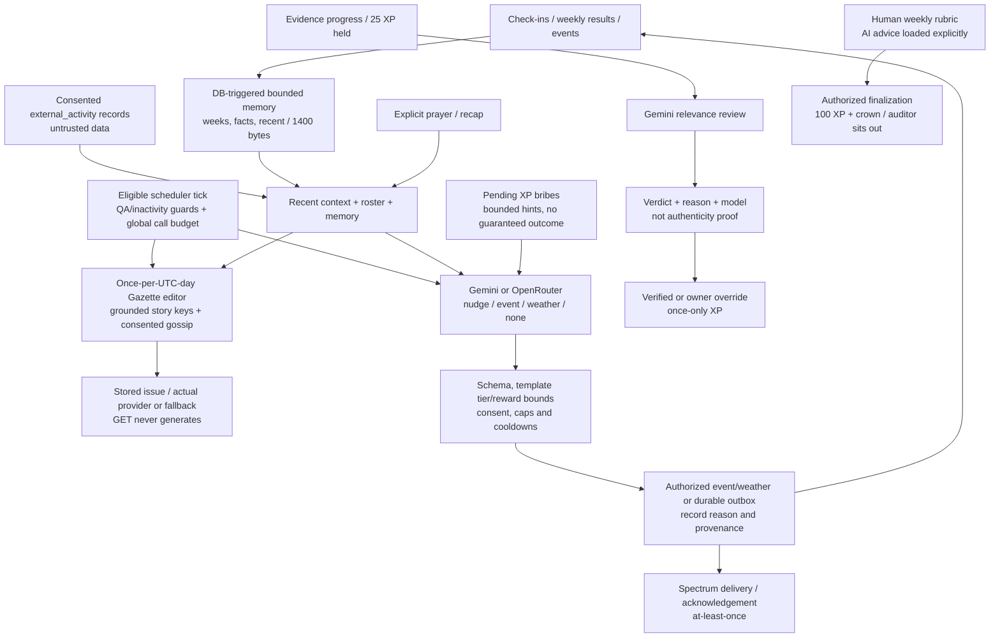

# Village architecture

DOCS-003 source snapshot: `77b382b`, October 10, 2026. Live API :8010 exposes 60 paths; health reports DB/GPU up and the stale API-004 label, not an immutable deploy SHA. Solid arrows show code interfaces, not proof of live end-to-end success. Dashed arrows mark pending integration. [README evidence table](../../README.md#features-and-evidence) records the boundaries.

## System, content and social layer

FastAPI owns product authorization and transactional rewards. GPU bridge and activity collector are explicit exceptions to API-only database access: the bridge leases jobs and commits manifest revisions; the collector records consented signals and feed activity. Spectrum never writes the DB directly. The collector requires its separate migration and operational account linking; it makes no messages, audio captures or XP awards. Its live Discord/Steam operation was not verified by [ACT-001](../../apps/activity/ACT-001-REPORT.md).

The catalog sync publishes definitions and shop-tagged rows without granting unlocks or removing inventory. Current API consumers use registry progression, prerequisites and styles. The current round scene and web fixture catalog retain hardcoded definitions after the grid scene revert. There are 134 shipped model files but only 101 registry model references; the 33 additional models/event packs are pending registry integration. [Content guide](content.md) preserves the authoring workflow and its original ARCH-001 evidence. Do not treat model availability as automatic placement in the scene.

Social routes are mounted and present live, while browser controls await WEB-014. Ordinary private message text is excluded from the public feed; poke/cheer events are visible. Relays require recipient consent and a phone. XP bribes atomically debit XP, then bounded scheduler logic can consume them with event creation and record Gazette attribution; SOL bribes remain intention only. Presence expires after 30 seconds and is process-local, not a shared multiplayer broker. Self-deletion covers documented local records/assets with provider/filesystem failure limits; external identities, backups, delivered messages and unattributed legacy prose are outside that guarantee. See [API-010](../../packages/contracts/proposals/API-010.md).

## Avatar, group-photo and photo-item pipelines

The diagram combines logical stages; claimed group crops bypass SAM re-segmentation. Group API code now accepts CV-005 `face_url` under `villages/{vid}/group/{job}/`, maps `box_xyxy` to `bbox`, and enqueues a `group_job_id` claim job. The web accepts `done`, and the village response supplies owner metadata: source changes address QA3-B01/B02. [QA-003](../../tests/QA-003-REPORT.md) remains historical failing evidence, not a post-fix pass. Shared-photo discovery/resume metadata remains incomplete; the panel supports manually entering the job ID. No fresh group upload or claim was made here.

CV-006 dispatches `outfit_from_photo` and `object_from_photo` in the bridge without altering avatar manifests. Worker endpoints `/item/outfit` and `/item/object` are internal GPU APIs, **not public Village API routes**. Public upload/poll/token/inventory and `items/<uid>/...` peer asset authorization are pending API-011. Historical CV-006 tests inserted jobs directly. See [CV-006](../cv/cv006.md) and [items.py](../../workers/gpu/items.py).

| Historical measurement | Report and boundary |
| --- | --- |
| 59.7 s cold personal upload to LAM manifest | [CV-002](../cv/cv002.md), RTX 5090/WSL; not the later stylized-head chain |
| Five cast avatars in 451 s; ten stock voice expression tracks | [CV-004](../cv/cv004.md); placeholders, not teammate clones |
| Group image: five crops, 24 s wall; claim copy 1.2 s | [CV-005](../cv/cv005.md); direct job insertion, later LAM/body work additional |
| Garment extraction about 0.7-1.0 s warm | [CV-006](../cv/cv006.md); cold model load longer, no Gemini call for outfits |
| Mug object 76 s loaded / 204 s cold wall | [CV-006](../cv/cv006.md); cached/stylized samples vary, not a latency guarantee |

Heavy models run serially in isolated environments; A2E can remain resident. Missing/generated assets are optional: procedural world and preset avatars continue without GPU work. Playback labels distinguish A2E from approximate amplitude motion. The old draft video used amplitude fallback after expression 404s; this is separate from successful historical CV expression jobs.

## Mayor, memory, Gazette and human decisions

Memory is record-derived compaction, not unconstrained autobiographical text generation. Four recent weekly results, member counters and event summaries compete for a 1,400-byte document budget. All external text and model output stay untrusted data. Event templates constrain solo/pair/group participation, effort, rewards and cosmetic penalties; recovery clears projected effects rather than destroying owned items. Explicit prayer/recap schemas differ from scheduled decisions. [API-009](../../packages/contracts/proposals/API-009.md) describes these policies.

Gazette selects/arranges recorded facts with vetted headlines and mild consent-aware gossip. Provider/budget failure stores a labeled fallback rather than pretending generation succeeded. The live edition read during DOCS-003 returned `fallback:gazette-v1`; API-011 is assigned to investigate quality. Global hourly reservations bound physical LLM attempts; ElevenLabs uses separate explicit-action controls. Set `MAYOR_SCHEDULER=0` for a manual rehearsal.

**Current UI integration blocker:** [client.ts](../../apps/web/src/api/client.ts) returns API JSON without adaptation. [gazette.ts](../../apps/web/src/api/gazette.ts) and components expect memory `entries[]` and flat issue `issue_date/stories/gossip`; live responses have memory `document` and Gazette `edition_date/content`. Direct access to missing `entries.length` or `stories.map` can fail rendering. Adapt the client to the API-009 contract (including latest-before-publication 404), then rerun live browser checks. Tier/effect endpoints also need browser consumption. Source/API shape inspection establishes the mismatch; DOCS-003 did not run a browser crash reproduction.

Human decisions remain authoritative for weekly grades and competition entries. Review tasks are process-local and may need replay after a crash. Outbox transport is at-least-once despite durable inbound dedupe and in-process acknowledgement retry. No live phone delivery, Auth0 interactive login, Solana deployment or Vultr hosting is certified by this document.

## Multi-agent build

Claude Code integrated; scoped Codex worktrees handled API, UI, scene, assets, tests and documentation; a Claude CV subagent handled the GPU lane. Contracts/proposals, additive migrations, reports and the [decision log](../DECISIONS.md) coordinated work. Integration verification remains necessary after merges: task completion and test counts alone do not prove a working combined demo.
